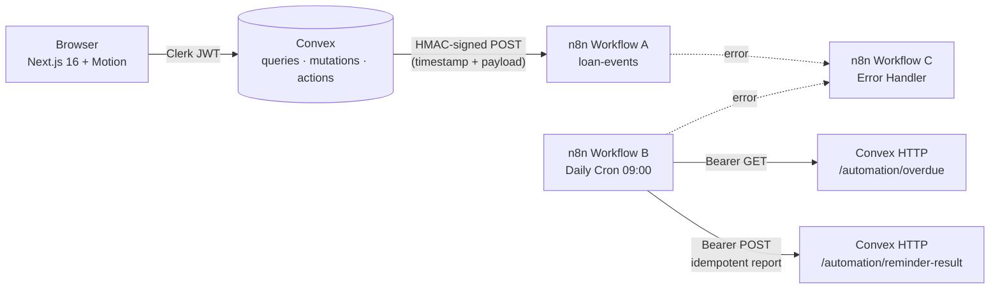

# LendLoop

> **Borrow what you need. Lend what you don’t.**  
> A high-trust neighborhood utility circle built with Next.js 16 (App Router), Convex reactive backend, Clerk for authentication, and n8n for workflow automation.

---

## Quickstart

You can assemble and run this full-stack application from scratch by following these steps.

### Prerequisites
- **Node.js**: v20 or higher (`node -v`)
- **Package Manager**: `pnpm` (`npm i -g pnpm`)
- **Accounts**:
  - [Convex](https://convex.dev) account
  - [Clerk](https://clerk.com) account
  - [n8n](https://n8n.io) instance (n8n Cloud, self-hosted Docker, or local)

---

### Step 1: Clone & Install Dependencies
```bash
git clone https://github.com/ruxy1212/lendloop
cd lendloop
pnpm install
```

---

### Step 2: Initialize Convex Backend
Run the Convex development server to link or create your deployment:
```bash
pnpm dlx convex dev
```
- Select your Convex team/project when prompted.
- This creates `convex/_generated/` and populates your deployment URLs. Keep this process running or run it in a separate terminal.

---

### Step 3: Configure Environment Variables

Create `.env.local` in the project root:
```env
# Clerk Authentication
NEXT_PUBLIC_CLERK_PUBLISHABLE_KEY=pk_test_...
CLERK_SECRET_KEY=sk_test_...

# Convex Deployment
NEXT_PUBLIC_CONVEX_URL=https://<your-deployment>.convex.cloud
NEXT_PUBLIC_CONVEX_SITE_URL=https://<your-deployment>.convex.site
```

Set server environment variables in your **Convex Deployment** (via Convex Dashboard &rarr; Settings &rarr; Environment Variables, or via CLI):
```bash
# Clerk Auth issuer domain
pnpm dlx convex env set CLERK_JWT_ISSUER_DOMAIN "https://<your-app>.clerk.accounts.dev"

# Outbound HMAC Webhook signing secret & target n8n URL
pnpm dlx convex env set N8N_WEBHOOK_URL "https://<your-n8n-url>/webhook/lendloop-loan-events"
pnpm dlx convex env set N8N_WEBHOOK_SECRET "choose-a-strong-secret-key"

# Inbound Bearer Token authenticating n8n requests into Convex HTTP actions
pnpm dlx convex env set AUTOMATION_API_KEY "choose-a-strong-bearer-token"
```

---

### Step 4: Configure Clerk Authentication & JWT Template

1. In the **Clerk Dashboard**, go to **Configure &rarr; JWT Templates**.
2. Click **New template** &rarr; select **Convex**.
3. Ensure the template name is `convex` and issuer claims are configured.
4. *(Optional & Recommended)* Add the name and email claims so Clerk passes your profile directly:
   ```json
   {
     "name": "{{user.full_name}}",
     "email": "{{user.primary_email_address}}"
   }
   ```
5. Copy your Clerk **Frontend API URL / Issuer** (e.g., `https://<your-app>.clerk.accounts.dev`) and ensure it matches `CLERK_JWT_ISSUER_DOMAIN` set in Step 3.

---

### Step 5: Import n8n Automation Workflows

Import the 3 JSON workflows located in [`n8n/workflows/`](./n8n/workflows/):

1. **`lendloop-loan-events.json`** (Workflow A):
   - Handles loan requested, approved, declined, and returned notifications.
   - Verifies HMAC signatures using `LENDLOOP_WEBHOOK_SECRET` (supports self-hosted container `$env` as well as n8n Cloud `$vars`).
   - Automatically reports failures to Workflow C (`lendloop-error-handler`).
2. **`lendloop-overdue-reminders.json`** (Workflow B):
   - Daily cron (09:00 UTC) querying `/automation/overdue` and reporting results to `/automation/reminder-result`.
   - Set Header Auth credential with `Authorization: Bearer <AUTOMATION_API_KEY>`.
   - Configured with `CONVEX_SITE_URL` (supports `$env` and `$vars`).
   - Connected to Workflow C (`lendloop-error-handler`) on execution failure.
3. **`lendloop-error-handler.json`** (Workflow C):
   - Global error trigger alerting admins on failed automation nodes.

Verify that exported workflow JSON files contain zero sensitive keys:
```bash
grep -rniE "bearer |secret|password|api[_-]?key" n8n/workflows/
```
*(Should return zero embedded secrets).*

Activate all three workflows.

---

### Step 6: Start Web Server & Bootstrap Admin Account

1. Start the Next.js development server:
   ```bash
   pnpm dev
   ```
2. Open [http://localhost:3000](http://localhost:3000) and sign in via Clerk.
3. Once signed in, promote your account to **Admin**:
   ```bash
   pnpm dlx convex run users:setRole '{\"email\":\"your-email@example.com\",\"role\":\"admin\"}'
   ```
4. Refresh your browser: the **Admin** console tab will now appear in your navigation bar!

---

## Environment Variables

| Name | Location | Purpose | Secret? |
| :--- | :--- | :--- | :---: |
| `NEXT_PUBLIC_CLERK_PUBLISHABLE_KEY` | `.env.local` | Clerk client-side authentication key | No |
| `CLERK_SECRET_KEY` | `.env.local` | Clerk server-side API key | **Yes** |
| `NEXT_PUBLIC_CONVEX_URL` | `.env.local` | Client connection URL to Convex WebSocket DB | No |
| `NEXT_PUBLIC_CONVEX_SITE_URL` | `.env.local` | Convex HTTP Actions endpoint base URL | No |
| `CLERK_JWT_ISSUER_DOMAIN` | Convex Env | Clerk domain issuer URL for verifying tokens | No |
| `N8N_WEBHOOK_URL` | Convex Env | Target URL of n8n webhook receiving loan lifecycle events | No |
| `N8N_WEBHOOK_SECRET` | Convex Env / n8n | Shared secret for signing & verifying outbound HMAC webhooks | **Yes** |
| `AUTOMATION_API_KEY` | Convex Env / n8n | Secret bearer token authenticating inbound n8n requests | **Yes** |

---

## Architecture



### Architectural Guarantees:
- **Convex is the single source of truth**: Authorization, role checks, and state transitions are strictly verified in backend functions; the frontend only adapts visual state.
- **Strict Data Minimization**: Public catalog endpoints return only tool names and categories. Borrower and lender emails never enter client-side state.
- **Idempotency & Resilience**: Automation dispatches are queued, retried with exponential backoff (5 attempts), and tracked in an append-only `automationEvents` table.

---

## Roles & Enforcement Matrix

| Operation | Function | Unauthenticated | Standard User | Tool Owner | Platform Admin |
| :--- | :--- | :---: | :---: | :---: | :---: |
| Browse public tools | `tools.publicList` | ✅ (name, cat only) | ✅ | ✅ | ✅ |
| Access active board | `tools.board` | ❌ `UNAUTHENTICATED` | ✅ | ✅ | ✅ |
| Create new tool | `tools.create` | ❌ `UNAUTHENTICATED` | ✅ | ✅ | ✅ |
| Update tool listing | `tools.update` | ❌ `UNAUTHENTICATED` | ❌ `FORBIDDEN` | ✅ | ❌ `FORBIDDEN` *(Owner only)* |
| Remove tool listing | `tools.remove` | ❌ `UNAUTHENTICATED` | ❌ `FORBIDDEN` | ✅ *(if not on loan)* | ✅ *(Override allowed)* |
| Request tool loan | `loans.request` | ❌ `UNAUTHENTICATED` | ✅ | ❌ *(Cannot borrow own)* | ✅ |
| Decide loan (Approve/Decline) | `loans.decide` | ❌ `UNAUTHENTICATED` | ❌ `FORBIDDEN` | ✅ | ❌ `FORBIDDEN` |
| Mark tool returned | `loans.markReturned` | ❌ `UNAUTHENTICATED` | ❌ `FORBIDDEN` | ✅ | ✅ *(Override allowed)* |
| Cancel pending loan | `loans.cancel` | ❌ `UNAUTHENTICATED` | ❌ `FORBIDDEN` | ❌ `FORBIDDEN` | ❌ *(Borrower only)* |
| Access admin telemetry | `admin.allLoans` | ❌ `UNAUTHENTICATED` | ❌ `FORBIDDEN` | ❌ `FORBIDDEN` | ✅ |
| Toggle Trusted Lender | `admin.setTrusted` | ❌ `UNAUTHENTICATED` | ❌ `FORBIDDEN` | ❌ `FORBIDDEN` | ✅ |

---

## Integration Design

### 1. Convex &rarr; n8n (Outbound Webhooks)
- **Signature**: Every event dispatched to n8n is signed with an `X-LendLoop-Signature` header calculated as `HMAC-SHA256(secret, timestamp + "." + rawBody)`.
- **Replay Protection**: The `X-LendLoop-Timestamp` header enforces a strict 5-minute validity window.
- **Constant-Time Verification**: n8n validates signatures using constant-time string comparison to prevent timing attacks.

### 2. n8n &rarr; Convex (Inbound Endpoints)
- **Authentication**: Inbound requests to `/automation/overdue` and `/automation/reminder-result` must supply a valid `Authorization: Bearer <AUTOMATION_BEARER_TOKEN>` header.
- **Safe Comparison**: Verified using `crypto.timingSafeEqual`.

### 3. Idempotency & Delivery Semantics
- **Deterministic Keys**: Overdue reminders generate deterministic keys formatted as `overdue_<loanId>_<YYYY-MM-DD>`.
- **State Monotonicity**: Events recorded in `automationEvents` can transition from `queued` &rarr; `sent`, but can never be downgraded.
- **At-Least-Once Delivery**: Automated retry logic guarantees delivery even across transient network interruptions.

---

## Security & Data Minimization

- **Zero Client PII Leaks**: The frontend never receives lender or borrower email addresses. Counterparts are rendered solely by their public first name, handle, or avatar.
- **Public API Isolation**: Unauthenticated users calling `tools.publicList` receive only `_id`, `name`, and `category`. Descriptions, condition notes, and owner IDs are stripped before returning.
- **Audit Logging**: All automated operations, webhook attempts, error traces, and status write-backs are persisted in `automationEvents`.
- **Zero Secrets in Version Control**: All workflow templates in `n8n/workflows/` use variable references (`$vars`) with zero embedded passwords, tokens, or live URLs.

---

## Automated Test Suite

The repository includes a comprehensive Vitest test suite executing against an in-memory Convex database backend ([`convex-test`](https://github.com/get-convex/convex-test)).

Run the tests:
```bash
pnpm test
```

### Coverage (10/10 Invariants Verified):
- **Test 1**: Signed-out `tools.publicList` returns only `_id`, `name`, and `category` (no PII, no owner IDs).
- **Test 2**: Signed-out calls to protected queries/mutations throw `UNAUTHENTICATED`.
- **Test 3**: User B cannot update or remove User A's tool (`FORBIDDEN`).
- **Test 4**: User A cannot borrow their own tool (`CANNOT_BORROW_OWN`).
- **Test 5**: User B cannot decide (approve/decline) User A's incoming loan request (`FORBIDDEN`).
- **Test 6**: Date range overlaps on pending/approved loans trigger `OVERLAP_CONFLICT`.
- **Test 7**: Non-admin users calling `admin.allLoans` or `admin.setTrusted` throw `FORBIDDEN`.
- **Test 8**: Admins can remove any listing and toggle Trusted Lender status.
- **Test 9**: Removing a tool transactionally cancels active and pending loans.
- **Test 10**: Overdue loans can be confirmed returned by either the owner or an admin.

### Production Readiness & Future Roadmap

To scale the current LendLoop app from this evaluation build to a compliance-ready B2B production platform, I would prioritize five key architectural upgrades:

1. **Enterprise Security & Compliance Controls**
* **Secrets Management:** Migrate static `.env` secrets to AWS Secrets Manager/Vault with zero-downtime dual-key rotation (eliminating direct `$env` reads in n8n).
* **Hardened Perimeter & Auth:** Move Clerk to a production domain with strict CSP/HSTS policies, isolated `/admin` routes (separating admin capabilities from public `/app` space), and automated GDPR/HIPAA endpoints for data retention and right-to-be-forgotten deletion.

2. **High-Availability & Production-Grade Automations**
* **Scalable n8n Architecture:** Upgrade n8n from single-container to queue mode backed by PostgreSQL and Redis, promoting workflows strictly via CI/CD pipelines rather than manual UI editing.
* **Bidirectional Trust & Resiliency:** Replace static Bearer tokens with mutual HMAC-SHA256 signature verification plus timestamp anti-replay checks, backed by an `eventId` deduplication cache in n8n for network partition safety.

3. **Production Messaging & Infrastructure**
* **Transactional Email Infrastructure:** Replace Ethereal/test SMTP with AWS SES or Resend, fully configured with domain SPF, DKIM, DMARC, and built-in user notification preference management.

4. **Compliance-Grade Auditability & Observability**
* **Immutable Audit Trail:** Expand automation logs into an append-only audit ledger capturing administrative role changes, moderation actions, and administrative views (who, what, when).
* **End-to-End Telemetry:** Integrate Sentry error tracking with OpenTelemetry/Datadog metrics, setting automated alerts if background crons fail or n8n webhook error rates spike.

5. **CI/CD & Delivery Pipeline**
* Implement automated pull-request testing with Playwright E2E suites, ephemeral preview environments, and static security analysis (SAST) prior to production deployment.
