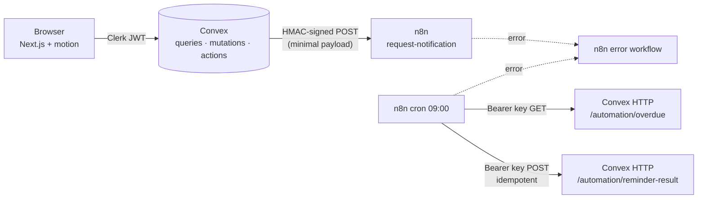
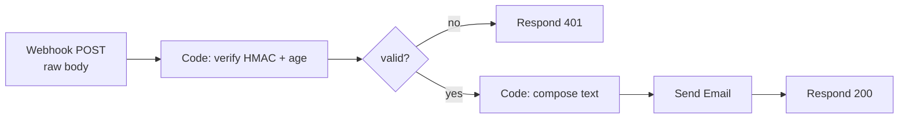
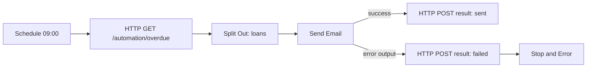

# LendLoop: Build Guide

A neighborhood tool-lending board. **Next.js (App Router) · Clerk · Convex · n8n · TypeScript · motion/react.**

This guide takes you from an empty folder to a submittable repo, in build order. Every phase ends with a checkpoint so you never stack bugs.

> **Budget:** ~14 to 18 hours. Backend + security ≈ 40%, n8n ≈ 20%, UI/motion ≈ 30%, docs ≈ 10%. Do not polish the UI before the backend rules pass the tests in Phase 10.

---

## 0. What you're building



**Three principles to hold to everywhere** (the evaluators are scoring these):

1. **Convex is the authority.** Role, ownership and state transitions are enforced in Convex functions. The UI only hides things.
2. **Minimum data crosses every boundary.** Public page: `name` + `category`. Webhook: only what the message needs. Emails of users never reach the browser.
3. **Every automated write is idempotent and every failure is visible.**

### Feature map

| Requirement | Where it lives |
|---|---|
| Public board (name + category only) | `tools.publicList` (no auth) |
| Sign in button | Clerk `<SignInButton mode="modal">` |
| List/edit/delete own tools | `tools.create / update / remove` |
| Request, approve/decline, return | `loans.request / decide / markReturned` |
| Filter by category, availability | `tools.board` |
| My listings / requests / incoming | `tools.mine`, `loans.mine`, `loans.incoming` |
| Admin: remove any, view all loans, Trusted Lender | `admin.*` |
| n8n request notifications | `automation.dispatch` → webhook workflow |
| n8n overdue reminders | cron workflow ↔ `convex/http.ts` |
| Bonus: activity on each loan | `automationEvents` joined into loan queries |

---

## 1. Scaffold

```bash
npx create-next-app@latest lendloop --typescript --tailwind --app --eslint --src-dir=true
cd lendloop

npm i convex @clerk/nextjs motion sonner clsx \
      @radix-ui/react-dialog react-day-picker date-fns

npx convex dev      # logs in, creates a project, writes NEXT_PUBLIC_CONVEX_URL to .env.local
```

Leave `npx convex dev` running in its own terminal for the whole build.

Project layout (create as you go):

```
lendloop/
├─ app/
│  ├─ layout.tsx · template.tsx · page.tsx            # public
│  └─ app/                                            # signed-in area
│     ├─ layout.tsx  page.tsx                         # browse
│     ├─ listings/page.tsx  requests/page.tsx
│     ├─ incoming/page.tsx  admin/page.tsx
├─ components/                                        # ui + motion components
├─ lib/ (motion.ts, utils.ts)
├─ convex/
│  ├─ schema.ts  auth.config.ts  constants.ts
│  ├─ lib/auth.ts  lib/loans.ts
│  ├─ users.ts  tools.ts  loans.ts  admin.ts
│  ├─ automation.ts  http.ts
├─ n8n/workflows/*.json
├─ docker-compose.yml  .env.example  README.md
```

---

## 2. Clerk → Convex auth

### 2.1 Clerk dashboard
1. Create an application (enable Email + Google).
2. **Configure → Integrations → Convex → Activate.** Copy the **Frontend API URL** (your issuer domain).
3. Copy the publishable and secret keys.

### 2.2 Environment

`.env.local` (Next.js)
```bash
NEXT_PUBLIC_CLERK_PUBLISHABLE_KEY=pk_test_...
CLERK_SECRET_KEY=sk_test_...
# NEXT_PUBLIC_CONVEX_URL is already written by `convex dev`
```

Convex deployment env (**not** `.env.local`):
```bash
npx convex env set CLERK_JWT_ISSUER_DOMAIN https://your-app.clerk.accounts.dev
```

### 2.3 `convex/auth.config.ts`
```ts
export default {
  providers: [
    {
      domain: process.env.CLERK_JWT_ISSUER_DOMAIN,
      applicationID: "convex",
    },
  ],
};
```

### 2.4 Middleware

`middleware.ts` (Next ≤ 15) or `proxy.ts` (Next 16+):
```ts
import { clerkMiddleware, createRouteMatcher } from "@clerk/nextjs/server";

const isProtected = createRouteMatcher(["/app(.*)"]);

export default clerkMiddleware(async (auth, req) => {
  if (isProtected(req)) await auth.protect();
});

export const config = {
  matcher: [
    "/((?!_next|[^?]*\\.(?:html?|css|js(?!on)|jpe?g|webp|png|gif|svg|ttf|woff2?|ico|csv|docx?|xlsx?|zip|webmanifest)).*)",
    "/(api|trpc)(.*)",
  ],
};
```

> Verify `createRouteMatcher()` against Clerk's current docs at install time; regardless of proxy routing, Convex remains the real data guard.

### 2.5 Providers

`components/convex-provider.tsx`
```tsx
"use client";
import { ReactNode } from "react";
import { ClerkProvider, useAuth } from "@clerk/nextjs";
import { ConvexReactClient } from "convex/react";
import { ConvexProviderWithClerk } from "convex/react-clerk";
import { MotionConfig } from "motion/react";
import { Toaster } from "sonner";

const convex = new ConvexReactClient(process.env.NEXT_PUBLIC_CONVEX_URL!);

export function Providers({ children }: { children: ReactNode }) {
  return (
    <ConvexProviderWithClerk client={convex} useAuth={useAuth}>
      <MotionConfig reducedMotion="user">
        {children}
        <Toaster position="bottom-center" />
      </MotionConfig>
    </ConvexProviderWithClerk>
  );
}
```

`app/layout.tsx`
```tsx
import "./globals.css";
import { ClerkProvider } from "@clerk/nextjs";
import { Geist, Instrument_Serif } from "next/font/google";
import { Providers } from "@/components/convex-provider";

const sans = Geist({ subsets: ["latin"], variable: "--font-geist" });
const display = Instrument_Serif({ subsets: ["latin"], weight: "400", variable: "--font-instrument" });

export const metadata = { title: "LendLoop", description: "Borrow what you need. Lend what you don’t." };

export default function RootLayout({ children }: { children: React.ReactNode }) {
  return (
    <ClerkProvider>
      <html lang="en" className={`${sans.variable} ${display.variable}`}>
        <body className="font-sans antialiased"><Providers>{children}</Providers></body>
      </html>
    </ClerkProvider>
  );
}
```

`MotionConfig reducedMotion="user"` makes every animation respect the OS "reduce motion" setting. Do not skip it.

✅ **Checkpoint:** `npm run dev` loads `/`, and `/app` redirects to sign-in.

---

## 3. Schema

`convex/constants.ts`
```ts
import { v } from "convex/values";

export const CATEGORIES = ["power-tools", "garden", "kitchen", "camping", "cleaning", "other"] as const;
export const CONDITIONS = ["like-new", "good", "worn"] as const;
export type Category = (typeof CATEGORIES)[number];

// Validators are written out explicitly so Convex infers precise literal types.
export const categoryV = v.union(
  v.literal("power-tools"), v.literal("garden"), v.literal("kitchen"),
  v.literal("camping"), v.literal("cleaning"), v.literal("other"),
);
export const conditionV = v.union(v.literal("like-new"), v.literal("good"), v.literal("worn"));
```

`convex/schema.ts`
```ts
import { defineSchema, defineTable } from "convex/server";
import { v } from "convex/values";
import { categoryV, conditionV } from "./constants";

export default defineSchema({
  users: defineTable({
    tokenIdentifier: v.string(),
    name: v.string(),
    email: v.string(),                    // server-side only; never returned to clients
    role: v.union(v.literal("admin"), v.literal("user")),
    trustedLender: v.boolean(),
  }).index("by_token", ["tokenIdentifier"]).index("by_email", ["email"]),

  tools: defineTable({
    ownerId: v.id("users"),
    name: v.string(),
    category: categoryV,
    condition: conditionV,
    description: v.string(),
  }).index("by_owner", ["ownerId"]).index("by_category", ["category"]),

  loans: defineTable({
    toolId: v.id("tools"),
    ownerId: v.id("users"),               // denormalized for indexed "incoming" lookups
    borrowerId: v.id("users"),
    startDate: v.string(),                // "YYYY-MM-DD"
    endDate: v.string(),
    status: v.union(
      v.literal("pending"), v.literal("approved"), v.literal("declined"),
      v.literal("returned"), v.literal("cancelled"),
    ),
    returnedAt: v.optional(v.number()),
  })
    .index("by_owner", ["ownerId"])
    .index("by_borrower", ["borrowerId"])
    .index("by_borrower_tool_status", ["borrowerId", "toolId", "status"])
    .index("by_tool_status", ["toolId", "status"])
    .index("by_status_end", ["status", "endDate"]),

  automationEvents: defineTable({
    loanId: v.id("loans"),
    kind: v.union(v.literal("request_notification"), v.literal("overdue_reminder")),
    idempotencyKey: v.string(),
    status: v.union(v.literal("sent"), v.literal("retrying"), v.literal("failed")),
    attempts: v.number(),
    detail: v.optional(v.string()),
    updatedAt: v.number(),
  }).index("by_key", ["idempotencyKey"]).index("by_loan", ["loanId"]),
});
```

Design notes worth repeating in your README:
- **"Overdue" and "on loan" are derived, not stored.** A loan is overdue when `status = approved` and `endDate < today`. One less state to desync.
- Dates are plain `YYYY-MM-DD` strings so lexicographic comparison equals chronological comparison, and timezone drift can't shift a booking by a day.
- `ownerId` on `loans` is denormalized deliberately for index lookups; it's set once, server-side, from the tool.

---

## 4. Server-side RBAC (the core of the assignment)

`convex/lib/auth.ts`
```ts
import { ConvexError } from "convex/values";
import type { QueryCtx, MutationCtx } from "../_generated/server";
import type { Doc } from "../_generated/dataModel";

type Ctx = QueryCtx | MutationCtx;

export async function requireUser(ctx: Ctx): Promise<Doc<"users">> {
  const identity = await ctx.auth.getUserIdentity();
  if (!identity) throw new ConvexError({ code: "UNAUTHENTICATED" });
  const user = await ctx.db
    .query("users")
    .withIndex("by_token", (q) => q.eq("tokenIdentifier", identity.tokenIdentifier))
    .unique();
  if (!user) throw new ConvexError({ code: "NO_PROFILE" });
  return user;
}

export async function requireAdmin(ctx: Ctx) {
  const user = await requireUser(ctx);
  if (user.role !== "admin") throw new ConvexError({ code: "FORBIDDEN" });
  return user;
}

export function assertOwner(user: Doc<"users">, ownerId: Doc<"users">["_id"]) {
  if (user._id !== ownerId) throw new ConvexError({ code: "FORBIDDEN" });
}
```

Rules to follow in **every** function:
- Identity comes from `ctx.auth`, never from an argument. No function takes `userId`, `role` or `ownerId` from the client.
- Every `get/patch/delete` by id is followed by an ownership check, because a valid `Id` is not authorization.
- Validate every argument with `v.*` **and** with business checks (lengths, date ranges, enums).
- Errors are `ConvexError({ code })` so the UI can map codes to short toasts without leaking internals.
- Admin is explicit: `requireAdmin` or `requireUser` + `assertOwner`. Nothing is "admin by omission".

### 4.1 Users and admin bootstrap

`convex/users.ts`
```ts
import { ConvexError, v } from "convex/values";
import { mutation, query, internalMutation } from "./_generated/server";
import { requireUser } from "./lib/auth";

export const store = mutation({
  args: {},
  handler: async (ctx) => {
    const identity = await ctx.auth.getUserIdentity();
    if (!identity) throw new ConvexError({ code: "UNAUTHENTICATED" });

    const existing = await ctx.db
      .query("users")
      .withIndex("by_token", (q) => q.eq("tokenIdentifier", identity.tokenIdentifier))
      .unique();

    const name = (identity.name ?? identity.givenName ?? "Neighbor").slice(0, 80);
    const email = identity.email ?? "";

    if (existing) {
      if (existing.name !== name || existing.email !== email) await ctx.db.patch(existing._id, { name, email });
      return existing._id;
    }
    // Role is ALWAYS "user" on creation. Promotion is an operator action (below).
    return ctx.db.insert("users", { tokenIdentifier: identity.tokenIdentifier, name, email, role: "user", trustedLender: false });
  },
});

export const me = query({
  args: {},
  handler: async (ctx) => {
    const identity = await ctx.auth.getUserIdentity();
    if (!identity) return null;
    const u = await ctx.db.query("users").withIndex("by_token", (q) => q.eq("tokenIdentifier", identity.tokenIdentifier)).unique();
    return u && { _id: u._id, name: u.name, role: u.role, trustedLender: u.trustedLender };   // no email
  },
});

// Internal: callable only from the CLI/dashboard, never from a client.
export const setRole = internalMutation({
  args: { email: v.string(), role: v.union(v.literal("admin"), v.literal("user")) },
  handler: async (ctx, { email, role }) => {
    const u = await ctx.db.query("users").withIndex("by_email", (q) => q.eq("email", email)).first();
    if (!u) throw new ConvexError({ code: "NOT_FOUND" });
    await ctx.db.patch(u._id, { role });
  },
});
```

Promote yourself after your first sign-in:
```bash
npx convex run users:setRole '{"email":"you@example.com","role":"admin"}'
```

Client hook that creates the profile on first load, `lib/use-store-user.ts`:
```ts
"use client";
import { useEffect } from "react";
import { useConvexAuth, useMutation } from "convex/react";
import { api } from "@/convex/_generated/api";

export function useStoreUser() {
  const { isAuthenticated } = useConvexAuth();
  const store = useMutation(api.users.store);
  useEffect(() => { if (isAuthenticated) void store(); }, [isAuthenticated, store]);
}
```

✅ **Checkpoint:** sign in, open the Convex dashboard → `users` has your row with `role: "user"`; run `setRole`; it flips to `admin`.

---

## 5. Domain functions

### 5.1 Shared helpers: `convex/lib/loans.ts`
```ts
import { ConvexError } from "convex/values";
import type { QueryCtx } from "../_generated/server";
import type { Id } from "../_generated/dataModel";

export const todayUTC = () => new Date().toISOString().slice(0, 10);
const ISO = /^\d{4}-\d{2}-\d{2}$/;

export function validateRange(start: string, end: string) {
  if (!ISO.test(start) || !ISO.test(end) || isNaN(Date.parse(start)) || isNaN(Date.parse(end)))
    throw new ConvexError({ code: "BAD_DATES" });
  if (start < todayUTC() || end < start) throw new ConvexError({ code: "BAD_DATES" });
  if ((Date.parse(end) - Date.parse(start)) / 86_400_000 > 30) throw new ConvexError({ code: "TOO_LONG" });
}

export async function hasOverlap(ctx: QueryCtx, toolId: Id<"tools">, start: string, end: string, exclude?: Id<"loans">) {
  const approved = await ctx.db
    .query("loans")
    .withIndex("by_tool_status", (q) => q.eq("toolId", toolId).eq("status", "approved"))
    .collect();
  return approved.some((l) => l._id !== exclude && l.startDate <= end && start <= l.endDate);
}

// "On loan" = an approved, unreturned loan that has started (includes overdue).
export async function isOnLoan(ctx: QueryCtx, toolId: Id<"tools">, today = todayUTC()) {
  const approved = await ctx.db
    .query("loans")
    .withIndex("by_tool_status", (q) => q.eq("toolId", toolId).eq("status", "approved"))
    .collect();
  return approved.some((l) => l.startDate <= today);
}
```

### 5.2 Tools: `convex/tools.ts`
```ts
import { ConvexError, v } from "convex/values";
import { mutation, query } from "./_generated/server";
import { categoryV, conditionV } from "./constants";
import { assertOwner, requireUser } from "./lib/auth";
import { isOnLoan } from "./lib/loans";

const fields = { name: v.string(), category: categoryV, condition: conditionV, description: v.string() };

function clean(a: { name: string; description: string }) {
  const name = a.name.trim(), description = a.description.trim();
  if (name.length < 2 || name.length > 60 || description.length > 280) throw new ConvexError({ code: "INVALID_INPUT" });
  return { name, description };
}

// PUBLIC: no auth, name + category only. No owner, no description, no ids that reveal people.
export const publicList = query({
  args: {},
  handler: async (ctx) => {
    const out: { _id: string; name: string; category: string }[] = [];
    for await (const t of ctx.db.query("tools").order("desc")) {
      if (!(await isOnLoan(ctx, t._id))) {
        out.push({ _id: t._id, name: t.name, category: t.category });
        if (out.length === 60) break;
      }
    }
    return out;
  },
});

// AUTHED board: everything, with availability. The UI filters by category client-side so layout animates instantly.
export const board = query({
  args: {},
  handler: async (ctx) => {
    await requireUser(ctx);
    const tools = await ctx.db.query("tools").order("desc").take(200);
    return Promise.all(tools.map(async (t) => {
      const owner = await ctx.db.get(t.ownerId);
      return {
        _id: t._id, name: t.name, category: t.category, condition: t.condition, description: t.description,
        ownerId: t.ownerId, ownerName: owner?.name ?? "Neighbor", trusted: owner?.trustedLender ?? false,
        status: (await isOnLoan(ctx, t._id)) ? ("on_loan" as const) : ("available" as const),
      };
    }));
  },
});

export const mine = query({
  args: {},
  handler: async (ctx) => {
    const user = await requireUser(ctx);
    return ctx.db.query("tools").withIndex("by_owner", (q) => q.eq("ownerId", user._id)).order("desc").take(100);
  },
});

export const create = mutation({
  args: fields,
  handler: async (ctx, a) => {
    const user = await requireUser(ctx);
    return ctx.db.insert("tools", { ownerId: user._id, category: a.category, condition: a.condition, ...clean(a) });
  },
});

export const update = mutation({
  args: { toolId: v.id("tools"), ...fields },
  handler: async (ctx, { toolId, ...a }) => {
    const user = await requireUser(ctx);
    const tool = await ctx.db.get(toolId);
    if (!tool) throw new ConvexError({ code: "NOT_FOUND" });
    assertOwner(user, tool.ownerId);                       // spec: edit only your own, even for admins
    await ctx.db.patch(toolId, { category: a.category, condition: a.condition, ...clean(a) });
  },
});

export const remove = mutation({
  args: { toolId: v.id("tools") },
  handler: async (ctx, { toolId }) => {
    const user = await requireUser(ctx);
    const tool = await ctx.db.get(toolId);
    if (!tool) throw new ConvexError({ code: "NOT_FOUND" });
    const isAdmin = user.role === "admin";
    if (!isAdmin) assertOwner(user, tool.ownerId);         // owner OR admin

    const loans = await ctx.db.query("loans").withIndex("by_tool_status", (q) => q.eq("toolId", toolId)).collect();
    if (!isAdmin && loans.some((l) => l.status === "approved")) throw new ConvexError({ code: "ON_LOAN" });
    for (const l of loans) if (l.status === "pending" || l.status === "approved") await ctx.db.patch(l._id, { status: "cancelled" });
    await ctx.db.delete(toolId);                           // mutations are transactional: all or nothing
  },
});
```

### 5.3 Loans: `convex/loans.ts`
```ts
import { ConvexError, v } from "convex/values";
import { internal } from "./_generated/api";
import type { Doc } from "./_generated/dataModel";
import { mutation, query, QueryCtx } from "./_generated/server";
import { assertOwner, requireUser } from "./lib/auth";
import { hasOverlap, todayUTC, validateRange } from "./lib/loans";

async function hydrate(ctx: QueryCtx, loan: Doc<"loans">, viewer: "owner" | "borrower") {
  const [tool, other, ev] = await Promise.all([
    ctx.db.get(loan.toolId),
    ctx.db.get(viewer === "owner" ? loan.borrowerId : loan.ownerId),
    ctx.db.query("automationEvents").withIndex("by_loan", (q) => q.eq("loanId", loan._id)).order("desc").first(),
  ]);
  return {
    _id: loan._id, status: loan.status, startDate: loan.startDate, endDate: loan.endDate,
    overdue: loan.status === "approved" && loan.endDate < todayUTC(),
    toolName: tool?.name ?? "Removed tool",
    counterpart: other?.name ?? "Neighbor",              // name only, never email
    activity: ev ? { kind: ev.kind, status: ev.status, at: ev.updatedAt } : null,   // bonus feature
  };
}

export const mine = query({
  args: {},
  handler: async (ctx) => {
    const u = await requireUser(ctx);
    const rows = await ctx.db.query("loans").withIndex("by_borrower", (q) => q.eq("borrowerId", u._id)).order("desc").take(100);
    return Promise.all(rows.map((l) => hydrate(ctx, l, "borrower")));
  },
});

export const incoming = query({
  args: {},
  handler: async (ctx) => {
    const u = await requireUser(ctx);
    const rows = await ctx.db.query("loans").withIndex("by_owner", (q) => q.eq("ownerId", u._id)).order("desc").take(100);
    return Promise.all(rows.map((l) => hydrate(ctx, l, "owner")));
  },
});

// For the date picker: approved ranges only, no identities.
export const bookedRanges = query({
  args: { toolId: v.id("tools") },
  handler: async (ctx, { toolId }) => {
    await requireUser(ctx);
    const rows = await ctx.db.query("loans").withIndex("by_tool_status", (q) => q.eq("toolId", toolId).eq("status", "approved")).collect();
    return rows.map((l) => ({ from: l.startDate, to: l.endDate }));
  },
});

export const request = mutation({
  args: { toolId: v.id("tools"), startDate: v.string(), endDate: v.string() },
  handler: async (ctx, a) => {
    const user = await requireUser(ctx);
    const tool = await ctx.db.get(a.toolId);
    if (!tool) throw new ConvexError({ code: "NOT_FOUND" });
    if (tool.ownerId === user._id) throw new ConvexError({ code: "OWN_TOOL" });
    validateRange(a.startDate, a.endDate);
    if (await hasOverlap(ctx, tool._id, a.startDate, a.endDate)) throw new ConvexError({ code: "CONFLICT" });

    const duplicate = await ctx.db
      .query("loans")
      .withIndex("by_borrower_tool_status", (q) =>
        q.eq("borrowerId", user._id).eq("toolId", tool._id).eq("status", "pending"),
      )
      .first();
    if (duplicate) throw new ConvexError({ code: "DUPLICATE" });

    const id = await ctx.db.insert("loans", {
      toolId: tool._id, ownerId: tool.ownerId, borrowerId: user._id,   // owner derived from the tool, never from the client
      startDate: a.startDate, endDate: a.endDate, status: "pending",
    });
    await ctx.scheduler.runAfter(0, internal.automation.dispatch, { loanId: id, event: "request_created" });
    return id;
  },
});

export const decide = mutation({
  args: { loanId: v.id("loans"), decision: v.union(v.literal("approve"), v.literal("decline")) },
  handler: async (ctx, { loanId, decision }) => {
    const user = await requireUser(ctx);
    const loan = await ctx.db.get(loanId);
    if (!loan) throw new ConvexError({ code: "NOT_FOUND" });
    assertOwner(user, loan.ownerId);
    if (loan.status !== "pending") throw new ConvexError({ code: "BAD_STATE" });

    if (decision === "approve") {
      if (loan.endDate < todayUTC()) throw new ConvexError({ code: "EXPIRED" });
      if (await hasOverlap(ctx, loan.toolId, loan.startDate, loan.endDate, loan._id)) throw new ConvexError({ code: "CONFLICT" });
    }
    const status = decision === "approve" ? "approved" : "declined";
    await ctx.db.patch(loanId, { status });
    await ctx.scheduler.runAfter(0, internal.automation.dispatch, {
      loanId, event: status === "approved" ? "request_approved" : "request_declined",
    });
  },
});

export const markReturned = mutation({
  args: { loanId: v.id("loans") },
  handler: async (ctx, { loanId }) => {
    const user = await requireUser(ctx);
    const loan = await ctx.db.get(loanId);
    if (!loan) throw new ConvexError({ code: "NOT_FOUND" });
    if (user.role !== "admin") assertOwner(user, loan.ownerId);   // the lender confirms the return
    if (loan.status !== "approved") throw new ConvexError({ code: "BAD_STATE" });
    await ctx.db.patch(loanId, { status: "returned", returnedAt: Date.now() });
    await ctx.scheduler.runAfter(0, internal.automation.dispatch, { loanId, event: "loan_returned" });
  },
});

export const cancel = mutation({
  args: { loanId: v.id("loans") },
  handler: async (ctx, { loanId }) => {
    const user = await requireUser(ctx);
    const loan = await ctx.db.get(loanId);
    if (!loan) throw new ConvexError({ code: "NOT_FOUND" });
    if (loan.borrowerId !== user._id) throw new ConvexError({ code: "FORBIDDEN" });
    if (loan.status !== "pending") throw new ConvexError({ code: "BAD_STATE" });
    await ctx.db.patch(loanId, { status: "cancelled" });
  },
});
```

> `ctx.scheduler.runAfter` inside a mutation is **transactional**: if the mutation fails, nothing is scheduled; if it succeeds, the dispatch is guaranteed to be scheduled exactly once. That's why the webhook is fired from a scheduled action, not from the mutation.

### 5.4 Admin: `convex/admin.ts`
```ts
import { v } from "convex/values";
import { mutation, query } from "./_generated/server";
import { requireAdmin } from "./lib/auth";

export const allLoans = query({
  args: {},
  handler: async (ctx) => {
    await requireAdmin(ctx);
    const loans = await ctx.db.query("loans").order("desc").take(200);
    return Promise.all(loans.map(async (l) => ({
      _id: l._id, status: l.status, startDate: l.startDate, endDate: l.endDate,
      toolName: (await ctx.db.get(l.toolId))?.name ?? "Removed tool",
      owner: (await ctx.db.get(l.ownerId))?.name ?? "?",
      borrower: (await ctx.db.get(l.borrowerId))?.name ?? "?",
    })));
  },
});

export const lenders = query({
  args: {},
  handler: async (ctx) => {
    await requireAdmin(ctx);
    const users = await ctx.db.query("users").take(200);
    return users.map((u) => ({ _id: u._id, name: u.name, role: u.role, trustedLender: u.trustedLender }));
  },
});

export const setTrusted = mutation({
  args: { userId: v.id("users"), trusted: v.boolean() },
  handler: async (ctx, { userId, trusted }) => {
    await requireAdmin(ctx);
    await ctx.db.patch(userId, { trustedLender: trusted });
  },
});
```
Admins remove any listing through `tools.remove` (already allows admin).

✅ **Checkpoint: prove RBAC before touching UI.** In the Convex dashboard → Functions, run as different identities (or write a quick `convex-test` suite) and confirm: user B cannot `update` A's tool, cannot `decide` on A's loan, cannot call `admin.allLoans`; an unauthenticated caller can only call `tools.publicList`.

---

## 6. Convex → n8n (signed, minimal, retried)

### 6.1 Secrets
```bash
openssl rand -hex 32     # run twice: webhook secret, automation API key

npx convex env set N8N_WEBHOOK_URL    https://<your-public-n8n>/webhook/lendloop-loan-events
npx convex env set N8N_WEBHOOK_SECRET <hex-1>
npx convex env set AUTOMATION_API_KEY <hex-2>
```

### 6.2 `convex/automation.ts`
```ts
import { v } from "convex/values";
import { internal } from "./_generated/api";
import { internalAction, internalMutation, internalQuery } from "./_generated/server";

export const eventV = v.union(
  v.literal("request_created"), v.literal("request_approved"),
  v.literal("request_declined"), v.literal("loan_returned"),
);
const kindV = v.union(v.literal("request_notification"), v.literal("overdue_reminder"));
const statusV = v.union(v.literal("sent"), v.literal("retrying"), v.literal("failed"));

const MAX_ATTEMPTS = 5;
const BACKOFF_MS = [0, 30_000, 120_000, 600_000, 1_800_000];

async function hmacHex(secret: string, message: string) {
  const key = await crypto.subtle.importKey("raw", new TextEncoder().encode(secret), { name: "HMAC", hash: "SHA-256" }, false, ["sign"]);
  const sig = await crypto.subtle.sign("HMAC", key, new TextEncoder().encode(message));
  return [...new Uint8Array(sig)].map((b) => b.toString(16).padStart(2, "0")).join("");
}

/** DATA MINIMIZATION: this is the entire payload n8n ever sees for a notification. */
export const buildPayload = internalQuery({
  args: { loanId: v.id("loans"), event: eventV },
  handler: async (ctx, { loanId, event }) => {
    const loan = await ctx.db.get(loanId);
    if (!loan) return null;
    const [tool, owner, borrower] = await Promise.all([ctx.db.get(loan.toolId), ctx.db.get(loan.ownerId), ctx.db.get(loan.borrowerId)]);
    if (!tool || !owner || !borrower) return null;
    const toOwner = event === "request_created";
    const recipient = toOwner ? owner : borrower;
    const other = toOwner ? borrower : owner;
    if (!recipient.email) return null;
    return {
      eventId: `${loanId}:${event}`,                       // deterministic = idempotent
      event,
      recipient: { name: recipient.name, email: recipient.email },
      counterpartName: other.name,
      toolName: tool.name,
      startDate: loan.startDate,
      endDate: loan.endDate,
    };
  },
});

export const alreadySent = internalQuery({
  args: { key: v.string() },
  handler: async (ctx, { key }) => {
    const e = await ctx.db.query("automationEvents").withIndex("by_key", (q) => q.eq("idempotencyKey", key)).unique();
    return e?.status === "sent";
  },
});

/** Upsert by idempotency key. A "sent" record is never downgraded. Safe to call repeatedly. */
export const record = internalMutation({
  args: {
    loanId: v.id("loans"), kind: kindV, idempotencyKey: v.string(), status: statusV,
    attempts: v.optional(v.number()), detail: v.optional(v.string()),
  },
  handler: async (ctx, a) => {
    const existing = await ctx.db.query("automationEvents").withIndex("by_key", (q) => q.eq("idempotencyKey", a.idempotencyKey)).unique();
    const detail = a.detail?.slice(0, 200);
    if (existing) {
      if (existing.status === "sent") return { duplicate: true };
      await ctx.db.patch(existing._id, { status: a.status, detail, attempts: a.attempts ?? existing.attempts, updatedAt: Date.now() });
      return { duplicate: false };
    }
    await ctx.db.insert("automationEvents", {
      loanId: a.loanId, kind: a.kind, idempotencyKey: a.idempotencyKey,
      status: a.status, attempts: a.attempts ?? 1, detail, updatedAt: Date.now(),
    });
    return { duplicate: false };
  },
});

export const dispatch = internalAction({
  args: { loanId: v.id("loans"), event: eventV, attempt: v.optional(v.number()) },
  handler: async (ctx, { loanId, event, attempt = 0 }): Promise<void> => {
    const payload = await ctx.runQuery(internal.automation.buildPayload, { loanId, event });
    if (!payload) return;
    if (await ctx.runQuery(internal.automation.alreadySent, { key: payload.eventId })) return;

    const body = JSON.stringify(payload);
    const ts = Date.now().toString();
    const signature = await hmacHex(process.env.N8N_WEBHOOK_SECRET!, `${ts}.${body}`);

    const ctrl = new AbortController();
    const timer = setTimeout(() => ctrl.abort(), 10_000);
    try {
      const res = await fetch(process.env.N8N_WEBHOOK_URL!, {
        method: "POST",
        headers: { "content-type": "application/json", "x-lendloop-timestamp": ts, "x-lendloop-signature": signature },
        body,
        signal: ctrl.signal,
      });
      if (!res.ok) throw new Error(`n8n responded ${res.status}`);
      await ctx.runMutation(internal.automation.record, {
        loanId, kind: "request_notification", idempotencyKey: payload.eventId, status: "sent", attempts: attempt + 1,
      });
    } catch (e) {
      const next = attempt + 1;
      const final = next >= MAX_ATTEMPTS;
      await ctx.runMutation(internal.automation.record, {
        loanId, kind: "request_notification", idempotencyKey: payload.eventId,
        status: final ? "failed" : "retrying", attempts: next, detail: e instanceof Error ? e.message : "unknown error",
      });
      if (!final) await ctx.scheduler.runAfter(BACKOFF_MS[next], internal.automation.dispatch, { loanId, event, attempt: next });
    } finally {
      clearTimeout(timer);
    }
  },
});

/** Used by the overdue endpoint: only loans that still need today's reminder. */
export const overdueLoans = internalQuery({
  args: { today: v.string() },
  handler: async (ctx, { today }) => {
    const loans = await ctx.db.query("loans")
      .withIndex("by_status_end", (q) => q.eq("status", "approved").lt("endDate", today))
      .take(200);
    const out = [];
    for (const l of loans) {
      const reminderKey = `${l._id}:reminder:${today}`;
      const done = await ctx.db.query("automationEvents").withIndex("by_key", (q) => q.eq("idempotencyKey", reminderKey)).unique();
      if (done?.status === "sent") continue;               // retries of the whole workflow never re-send
      const [tool, borrower] = await Promise.all([ctx.db.get(l.toolId), ctx.db.get(l.borrowerId)]);
      if (!tool || !borrower?.email) continue;
      out.push({
        loanId: l._id, reminderKey, toolName: tool.name,
        borrowerName: borrower.name, borrowerEmail: borrower.email, endDate: l.endDate,
        daysOverdue: Math.round((Date.parse(today) - Date.parse(l.endDate)) / 86_400_000),
      });
    }
    return out;
  },
});
```

> **Why a custom retry loop?** Convex actions run at-most-once and are not auto-retried. The `scheduler.runAfter` backoff + a persisted `retrying/failed` status gives you at-least-once delivery with visible state. If TypeScript complains about circular type inference on `internal.automation.*`, keep the explicit `Promise<void>` return type on `dispatch` and add explicit return types to `buildPayload`.

### 6.3 `convex/http.ts` (n8n → Convex)
```ts
import { httpRouter } from "convex/server";
import { httpAction } from "./_generated/server";
import { internal } from "./_generated/api";

const http = httpRouter();

function safeEqual(a: string, b: string) {
  if (a.length !== b.length) return false;
  let d = 0;
  for (let i = 0; i < a.length; i++) d |= a.charCodeAt(i) ^ b.charCodeAt(i);
  return d === 0;
}
const authorized = (req: Request) =>
  safeEqual(req.headers.get("authorization") ?? "", `Bearer ${process.env.AUTOMATION_API_KEY}`);

http.route({
  path: "/automation/overdue",
  method: "GET",
  handler: httpAction(async (ctx, req) => {
    if (!authorized(req)) return new Response("Unauthorized", { status: 401 });
    const today = new URL(req.url).searchParams.get("today") ?? "";
    if (!/^\d{4}-\d{2}-\d{2}$/.test(today)) return new Response("Bad request", { status: 400 });
    const loans = await ctx.runQuery(internal.automation.overdueLoans, { today });
    return Response.json({ loans });
  }),
});

http.route({
  path: "/automation/reminder-result",
  method: "POST",
  handler: httpAction(async (ctx, req) => {
    if (!authorized(req)) return new Response("Unauthorized", { status: 401 });
    let b: any;
    try { b = await req.json(); } catch { return new Response("Bad request", { status: 400 }); }

    const okKey = typeof b?.idempotencyKey === "string" &&
      typeof b?.loanId === "string" &&
      b.idempotencyKey.startsWith(`${b.loanId}:reminder:`) &&
      /^\d{4}-\d{2}-\d{2}$/.test(b.idempotencyKey.slice(-10));
    if (!okKey || !["sent", "failed"].includes(b.status)) return new Response("Bad request", { status: 400 });

    try {
      const r = await ctx.runMutation(internal.automation.record, {
        loanId: b.loanId, kind: "overdue_reminder", idempotencyKey: b.idempotencyKey,
        status: b.status, detail: typeof b.detail === "string" ? b.detail : undefined,
      });
      return Response.json({ ok: true, duplicate: r.duplicate });   // retries get 200, not 409
    } catch {
      return new Response("Bad request", { status: 400 });          // e.g. invalid loan id
    }
  }),
});

export default http;
```

Your HTTP base URL is the **`.convex.site`** domain (not `.convex.cloud`): Convex dashboard → Settings → URL & Deploy Key → *HTTP Actions URL*.

✅ **Checkpoint:** from the dashboard, create a request. In `automationEvents` you see `retrying` (n8n isn't up yet). That's the retry loop working. Continue.

---

## 7. n8n

### 7.1 Run it

`docker-compose.yml`
```yaml
services:
  n8n:
    image: n8nio/n8n:<PINNED_2X_TAG>   # pin an exact 2.x version from Docker Hub at install time
    restart: unless-stopped
    ports: ["5678:5678"]
    environment:
      GENERIC_TIMEZONE: ${TZ:-Africa/Lagos}
      TZ: ${TZ:-Africa/Lagos}
      N8N_ENCRYPTION_KEY: ${N8N_ENCRYPTION_KEY}       # keeps stored credentials decryptable
      WEBHOOK_URL: ${N8N_PUBLIC_URL}                  # public URL Convex will call
      NODE_FUNCTION_ALLOW_BUILTIN: crypto             # lets the Code node use HMAC
      N8N_BLOCK_ENV_ACCESS_IN_NODE: "false"           # lets nodes read $env (see note below)
      LENDLOOP_WEBHOOK_SECRET: ${LENDLOOP_WEBHOOK_SECRET}
      CONVEX_SITE_URL: ${CONVEX_SITE_URL}
    volumes:
      - n8n_data:/home/node/.n8n
      - ./n8n/workflows:/workflows

  mailpit:                              # local SMTP sink + inbox UI at :8025
    image: axllent/mailpit
    ports: ["8025:8025", "1025:1025"]
    environment:
      MP_SMTP_AUTH_ACCEPT_ANY: "1"
      MP_SMTP_AUTH_ALLOW_INSECURE: "1"

volumes:
  n8n_data:
```

`.env` (repo root, git-ignored; ship `.env.example` with empty values)
```bash
N8N_ENCRYPTION_KEY=        # openssl rand -hex 24
LENDLOOP_WEBHOOK_SECRET=   # same value as Convex N8N_WEBHOOK_SECRET
CONVEX_SITE_URL=https://<deployment>.convex.site
N8N_PUBLIC_URL=            # set in 7.2
TZ=Africa/Lagos
```

> **Env access & Task Runners note.** The HMAC check needs the secret inside a Code node, which means `$env` must be readable. That's acceptable on a single-tenant self-hosted instance; say so in your README and list "external secrets provider" in your production note. If you run n8n 2.x with external Task Runners enabled, Code-node environment variables (`LENDLOOP_WEBHOOK_SECRET`, `NODE_FUNCTION_ALLOW_BUILTIN`, `N8N_BLOCK_ENV_ACCESS_IN_NODE`) must be set on the Task Runners rather than only the main `n8n` service—and verify `NODE_FUNCTION_ALLOW_BUILTIN` isn't overridden by a runner launcher config. Run the signed webhook smoke test (§7.7) immediately after activating Workflow A to confirm `crypto` and `getBinaryDataBuffer` work in your pinned image before building further.

### 7.2 Make it reachable by Convex

Convex runs in the cloud, so it **cannot** call `localhost:5678`. Expose n8n with a tunnel:

```bash
cloudflared tunnel --url http://localhost:5678      # or: ngrok http 5678
# copy the https URL it prints, put it in .env as N8N_PUBLIC_URL

docker compose up -d
npx convex env set N8N_WEBHOOK_URL "<that-url>/webhook/lendloop-loan-events"
```
Quick-tunnel URLs change on restart; update both values when they do. (n8n Cloud skips this step entirely.)

Open `http://localhost:5678`, create the owner account.

### 7.3 Credentials (the only place secrets live)

| Name | Type | Values |
|---|---|---|
| `Convex Automation Key` | Header Auth | Name `Authorization` · Value `Bearer <AUTOMATION_API_KEY>` |
| `Mailpit SMTP` | SMTP | host `mailpit` · port `1025` · SSL off · any dummy user/password |

Workflow JSON exports only store credential *names/ids*, never values. The HMAC secret is read from the container env, so it also never appears in JSON.

### 7.4 Workflow A: `LendLoop · Loan events`



**Webhook node**: Method `POST` · Path `lendloop-loan-events` · Authentication `None` (the HMAC *is* the auth) · Respond `Using 'Respond to Webhook' Node` · Options → **Raw Body: on**.

Responding only after the email step means a downstream failure returns a 5xx to Convex, which then retries with backoff.

**Code node: "Verify signature"** (Run Once for All Items)
```js
const crypto = require('crypto');

const item = $input.first();
const headers = item.json.headers || {};
const ts = headers['x-lendloop-timestamp'];
const sig = headers['x-lendloop-signature'] || '';

const raw = await this.helpers.getBinaryDataBuffer(0, 'data');   // exact bytes Convex signed
const body = raw.toString('utf8');

const fresh = ts && Math.abs(Date.now() - Number(ts)) < 5 * 60 * 1000;   // blocks replays
const expected = crypto.createHmac('sha256', $env.LENDLOOP_WEBHOOK_SECRET)
  .update(`${ts}.${body}`).digest('hex');

const a = Buffer.from(sig, 'hex');
const b = Buffer.from(expected, 'hex');
const valid = Boolean(fresh) && a.length === b.length && crypto.timingSafeEqual(a, b);

return [{ json: { valid, payload: valid ? JSON.parse(body) : null } }];
```

**IF node**: `{{ $json.valid }}` is true. *False* → **Respond to Webhook**: code `401`, body `{"ok":false}`.

**Code node: "Compose message"** (plain text only, so user-supplied names can't inject HTML)
```js
const p = $json.payload;
const when = `${p.startDate} → ${p.endDate}`;
const copy = {
  request_created:  [`New request: ${p.toolName}`,        `${p.counterpartName} would like to borrow it (${when}).`],
  request_approved: [`Approved: ${p.toolName}`,           `${p.counterpartName} approved your request (${when}).`],
  request_declined: [`Declined: ${p.toolName}`,           `${p.counterpartName} can't lend it this time.`],
  loan_returned:    [`Returned: ${p.toolName}`,           `${p.counterpartName} marked it as returned. Thanks!`],
}[p.event];
if (!copy) throw new Error(`Unknown event: ${p.event}`);
return [{ json: { to: p.recipient.email, subject: copy[0], text: `Hi ${p.recipient.name},\n\n${copy[1]}\n\n- LendLoop` } }];
```

**Send Email node**: Credential `Mailpit SMTP` · From `LendLoop <noreply@lendloop.local>` · To `{{ $json.to }}` · Subject `{{ $json.subject }}` · Email format `Text` · Text `{{ $json.text }}` · Settings → **Retry On Fail** (3 tries, 5000 ms).

**Respond to Webhook (success)**: `200`, body `{"ok":true}`.

> **Delivery semantics (say this in your README):** at-least-once. Convex skips events already marked `sent` and the event id is deterministic, but if n8n sends the email and the response is lost, a retry can duplicate one email. Production fix: a dedupe store keyed by `eventId` inside n8n.

### 7.5 Workflow B: `LendLoop · Overdue reminders`



1. **Schedule Trigger**: every day, 09:00. Workflow Settings → Timezone = yours.
2. **HTTP Request "Fetch overdue"**: `GET {{ $env.CONVEX_SITE_URL }}/automation/overdue` · Query param `today` = `{{ $now.toFormat('yyyy-MM-dd') }}` · Authentication: Generic → Header Auth → `Convex Automation Key` · Settings → Retry On Fail (3 tries, 5000 ms).
3. **Split Out**: Field `loans`. With zero overdue loans the run ends quietly.
4. **Send Email**: To `{{ $json.borrowerEmail }}` · Subject `Due back: {{ $json.toolName }}` · Text:
   ```
   Hi {{ $json.borrowerName }}, "{{ $json.toolName }}" was due {{ $json.endDate }} ({{ $json.daysOverdue }}d ago). Please return it when you can.
   ```
   Settings → **On Error: Continue (using error output)** · Retry On Fail (2 tries).
5. **HTTP Request "Write back: sent"** (from the *success* output): `POST {{ $env.CONVEX_SITE_URL }}/automation/reminder-result` · Header Auth credential · JSON body:
   ```json
   {
     "loanId": "{{ $('Split Out').item.json.loanId }}",
     "idempotencyKey": "{{ $('Split Out').item.json.reminderKey }}",
     "status": "sent"
   }
   ```
   Retry On Fail (3 tries). Re-running is safe: Convex upserts by `idempotencyKey` and `sent` is never downgraded.
6. **HTTP Request "Write back: failed"** (from the *error* output): same body with `"status": "failed", "detail": "{{ String($json.error ?? 'send failed').slice(0, 150) }}"`.
7. **Stop and Error** after the failed write-back: message `Reminder email failed`. This makes the **run itself** fail, so the error workflow fires. "Continue on error" alone would hide it.

The idempotency key is built **server-side** (`loanId:reminder:YYYY-MM-DD`) and merely echoed by n8n. A borrower is reminded once per day, and again tomorrow while still overdue.

### 7.6 Workflow C: `LendLoop · Error handler`

1. **Error Trigger**.
2. **Send Email** (Mailpit): To `ops@lendloop.local` · Subject `[LendLoop] {{ $json.workflow.name }} failed` · Text:
   ```
   {{ $json.execution.error.message }}
   Last node: {{ $json.execution.lastNodeExecuted }}
   {{ $json.execution.url }}
   ```
3. In **Workflows A and B → Settings → Error Workflow**, select this one.

Error Trigger fires on production (activated) runs, not manual test runs. In production, swap the email for Slack/Discord/PagerDuty.

### 7.7 Activate and test

Toggle A and B to **Active** (labelled *Publish* in newer versions). Test URLs (`/webhook-test/`) differ from production URLs (`/webhook/`); Convex must use the production one.

Run this signed smoke test **immediately after bringing n8n up and activating Workflow A**, before wiring up or debugging anything else, to verify your pinned image, runner env vars, `crypto`, and `getBinaryDataBuffer` end to end.

Signed test from your terminal (GNU `date`; on macOS use `python3 -c 'import time;print(int(time.time()*1000))'`):
```bash
SECRET=<LENDLOOP_WEBHOOK_SECRET>; URL=<N8N_PUBLIC_URL>/webhook/lendloop-loan-events
BODY='{"eventId":"t:1","event":"request_created","recipient":{"name":"Ada","email":"ada@example.com"},"counterpartName":"Tunde","toolName":"Drill","startDate":"2030-01-01","endDate":"2030-01-03"}'
TS=$(date +%s%3N)
SIG=$(printf '%s.%s' "$TS" "$BODY" | openssl dgst -sha256 -hmac "$SECRET" -hex | sed 's/^.* //')

curl -i -X POST "$URL" -H 'content-type: application/json' \
  -H "x-lendloop-timestamp: $TS" -H "x-lendloop-signature: $SIG" -d "$BODY"          # 200, mail in Mailpit
curl -i -X POST "$URL" -H 'content-type: application/json' \
  -H "x-lendloop-timestamp: $TS" -H "x-lendloop-signature: bad" -d "$BODY"           # 401
```

### 7.8 Export workflows (no secrets)

```bash
docker compose exec n8n n8n export:workflow --backup --output=/workflows/
# (if you hit a permissions error, use the editor: ⋯ → Download, and save into n8n/workflows/)

grep -rniE "bearer |secret|password|api[_-]?key" n8n/workflows/   # must print nothing sensitive
```
Re-import on a fresh machine: `docker compose exec n8n n8n import:workflow --separate --input=/workflows/`, then recreate the two credentials by name.

✅ **Checkpoint:** create a request in the app → email appears in Mailpit (`localhost:8025`) → `automationEvents` shows `sent`. Stop n8n, create another → status `retrying`; start n8n → it flips to `sent`.

---

## 8. UI system

The goal: **calm, tactile, fast.** Warm paper surfaces, one editorial serif for moments that matter, one sans for everything else, one accent. Motion explains state changes; it never decorates.

### 8.1 Rules (print these)

- **Copy is tiny.** Buttons ≤ 3 words. Empty states are one line + one action. Toasts ≤ 4 words. No helper paragraphs, no "Welcome back!" banners.
- **Animate only `transform`, `opacity`, (sparingly) `filter`.** Never width/height except collapsing rows.
- **One spring for UI, one ease for entrances.** Consistency is what makes it feel expensive.
- **Total entrance time < 600 ms.** Stagger ≤ 40 ms, cap at 8 items.
- **Every async action has 3 states:** idle → pending (instant, optimistic where safe) → result (toast).
- **Loading uses skeletons matching final layout.** `useQuery` returns `undefined` while loading, `[]` when empty; treat them differently.
- **`MotionConfig reducedMotion="user"`** is already in the provider. Test with the OS setting on.
- Touch targets ≥ 44 px. Visible `:focus-visible` rings. Contrast ≥ 4.5:1 in both themes.

### 8.2 Tokens: `app/globals.css` (Tailwind v4)
```css
@import "tailwindcss";
@import "react-day-picker/style.css";

@theme inline {
  --font-sans: var(--font-geist);
  --font-display: var(--font-instrument);
  --color-paper: var(--paper);
  --color-card: var(--card);
  --color-ink: var(--ink);
  --color-mute: var(--mute);
  --color-line: var(--line);
  --color-moss: var(--moss);
  --color-ember: var(--ember);
  --color-danger: var(--danger);
}

:root {
  --paper: #f6f3ec;  --card: #ffffff;  --ink: #16150f;  --mute: #6b6a60;
  --line: #e3dfd3;   --moss: #2e4a3b;  --ember: #e4572e; --danger: #b3261e;
}
@media (prefers-color-scheme: dark) {
  :root {
    --paper: #12130f; --card: #1b1c17; --ink: #f2efe6; --mute: #9a9889;
    --line: #2b2c25;  --moss: #8fbf9f; --ember: #ff7a4d; --danger: #ff8a80;
  }
}

body { background: var(--paper); color: var(--ink); }
::selection { background: var(--ember); color: #fff; }
:focus-visible { outline: 2px solid var(--ember); outline-offset: 2px; border-radius: 8px; }

.rdp-root {
  --rdp-accent-color: var(--moss);
  --rdp-accent-background-color: color-mix(in oklab, var(--moss) 16%, transparent);
  --rdp-day_button-border-radius: 12px;
}
.no-scrollbar::-webkit-scrollbar { display: none; }
```

### 8.3 Motion primitives: `lib/motion.ts`
```ts
export const spring = { type: "spring", stiffness: 420, damping: 34, mass: 0.8 } as const;   // UI
export const soft   = { type: "spring", stiffness: 220, damping: 26 } as const;               // sheets, large moves
export const ease   = [0.22, 1, 0.36, 1] as const;                                           // entrances
```

### 8.4 Utilities: `lib/utils.ts`
```ts
import clsx, { type ClassValue } from "clsx";
import { format, parseISO } from "date-fns";
import { toast } from "sonner";

export const cn = (...i: ClassValue[]) => clsx(i);
export const fmtRange = (s: string, e: string) => `${format(parseISO(s), "MMM d")} – ${format(parseISO(e), "MMM d")}`;

export function ago(ts: number) {
  const d = (ts - Date.now()) / 1000, rtf = new Intl.RelativeTimeFormat("en", { numeric: "auto" });
  for (const [u, s] of [["day", 86400], ["hour", 3600], ["minute", 60]] as const)
    if (Math.abs(d) >= s) return rtf.format(Math.round(d / s), u);
  return "just now";
}

const COPY: Record<string, string> = {
  UNAUTHENTICATED: "Sign in first.", FORBIDDEN: "Not allowed.", NOT_FOUND: "Not found.",
  CONFLICT: "Those dates are taken.", BAD_DATES: "Check the dates.", TOO_LONG: "30 days max.",
  OWN_TOOL: "That’s yours.", DUPLICATE: "Already requested.", BAD_STATE: "Already updated.",
  ON_LOAN: "Currently on loan.", INVALID_INPUT: "Check the fields.", EXPIRED: "Dates have passed.",
};
export function toastError(e: unknown) {
  toast.error(COPY[(e as { data?: { code?: string } })?.data?.code ?? ""] ?? "Something went wrong.");
}
```

### 8.5 Signature moments

**Hero tagline: masked word reveal + a ring that draws itself** (`components/hero.tsx`)
```tsx
"use client";
import { motion } from "motion/react";
import { ease } from "@/lib/motion";

const words = ["Borrow", "what", "you", "need.", "Lend", "what", "you", "don’t."];

export function Hero() {
  return (
    <div className="relative">
      <svg aria-hidden className="absolute -right-10 -top-16 size-64 md:size-96 opacity-80" viewBox="0 0 100 100">
        <motion.circle cx="50" cy="50" r="42" fill="none" stroke="var(--ember)" strokeWidth="1.2" strokeLinecap="round"
          initial={{ pathLength: 0 }} animate={{ pathLength: 1 }} transition={{ duration: 1.6, ease, delay: 0.2 }} />
      </svg>
      <h1 className="relative font-display text-[clamp(3rem,9vw,7.5rem)] leading-[0.95] tracking-tight">
        {words.map((w, i) => (
          <span key={i} className="mr-[0.22em] inline-block overflow-hidden pb-[0.12em] align-bottom">
            <motion.span className="inline-block" initial={{ y: "110%" }} animate={{ y: 0 }}
              transition={{ duration: 0.7, ease, delay: 0.05 * i }}>{w}</motion.span>
          </span>
        ))}
      </h1>
    </div>
  );
}
```

**Category filter: one pill that glides between options** (`components/category-filter.tsx`)
```tsx
"use client";
import { LayoutGroup, motion } from "motion/react";
import { CATEGORIES } from "@/convex/constants";
import { spring } from "@/lib/motion";
import { cn } from "@/lib/utils";

export function CategoryFilter({ id, value, onChange }: { id: string; value: string; onChange: (v: string) => void }) {
  return (
    <LayoutGroup id={id}>                      {/* unique id per instance, or pills fight each other */}
      <div role="tablist" className="no-scrollbar -mx-1 flex gap-1 overflow-x-auto px-1">
        {["all", ...CATEGORIES].map((c) => (
          <button key={c} role="tab" aria-selected={value === c} onClick={() => onChange(c)}
            className={cn("relative shrink-0 rounded-full px-3.5 py-2 text-sm capitalize transition-colors",
              value === c ? "text-paper" : "text-mute hover:text-ink")}>
            {value === c && <motion.span layoutId="pill" transition={spring} className="absolute inset-0 rounded-full bg-ink" />}
            <span className="relative">{c.replace("-", " ")}</span>
          </button>
        ))}
      </div>
    </LayoutGroup>
  );
}
```

**Animated grid: filtering reflows smoothly, first load staggers** (`components/tool-grid.tsx`)
```tsx
"use client";
import { AnimatePresence, motion } from "motion/react";
import { spring } from "@/lib/motion";

export function ToolGrid<T extends { _id: string }>({ items, render }: { items: T[]; render: (t: T) => React.ReactNode }) {
  return (
    <motion.ul layout className="grid gap-3 sm:grid-cols-2 lg:grid-cols-3">
      <AnimatePresence mode="popLayout">
        {items.map((t, i) => (
          <motion.li key={t._id} layout
            initial={{ opacity: 0, y: 14, scale: 0.98 }}
            animate={{ opacity: 1, y: 0, scale: 1, transition: { ...spring, delay: Math.min(i, 8) * 0.035 } }}
            exit={{ opacity: 0, scale: 0.96, transition: { duration: 0.15 } }}
            transition={spring}                 {/* governs layout moves; entrance delay lives in `animate` */}
            whileHover={{ y: -3 }} whileTap={{ scale: 0.985 }}>
            {render(t)}
          </motion.li>
        ))}
      </AnimatePresence>
    </motion.ul>
  );
}
```
> The `delay` is placed inside `animate.transition` on purpose. If you put it on the top-level `transition`, every later re-layout inherits the delay and filtering feels laggy.

**Bottom sheet: drag-to-dismiss, no scroll-lock bugs** (`components/sheet.tsx`)
```tsx
"use client";
import * as Dialog from "@radix-ui/react-dialog";
import { AnimatePresence, motion, useDragControls } from "motion/react";
import { soft } from "@/lib/motion";

export function Sheet({ open, onOpenChange, title, children }:
  { open: boolean; onOpenChange: (o: boolean) => void; title: string; children: React.ReactNode }) {
  const controls = useDragControls();
  return (
    <Dialog.Root open={open} onOpenChange={onOpenChange}>
      <AnimatePresence>
        {open && (
          <Dialog.Portal forceMount>
            <Dialog.Overlay asChild>
              <motion.div className="fixed inset-0 z-40 bg-ink/30 backdrop-blur-[2px]"
                initial={{ opacity: 0 }} animate={{ opacity: 1 }} exit={{ opacity: 0 }} />
            </Dialog.Overlay>
            <Dialog.Content asChild aria-describedby={undefined}>
              <motion.div
                className="fixed inset-x-0 bottom-0 z-50 mx-auto w-full max-w-lg rounded-t-[28px] bg-card p-6 pb-[max(1.5rem,env(safe-area-inset-bottom))] shadow-2xl outline-none"
                initial={{ y: "100%" }} animate={{ y: 0 }} exit={{ y: "100%" }} transition={soft}
                drag="y" dragControls={controls} dragListener={false}
                dragConstraints={{ top: 0, bottom: 0 }} dragElastic={{ top: 0, bottom: 0.6 }}
                onDragEnd={(_, i) => { if (i.offset.y > 120 || i.velocity.y > 600) onOpenChange(false); }}>
                <div onPointerDown={(e) => controls.start(e)} className="mx-auto mb-5 h-1.5 w-10 cursor-grab touch-none rounded-full bg-line" />
                <Dialog.Title className="font-display text-3xl">{title}</Dialog.Title>
                <div className="mt-5">{children}</div>
              </motion.div>
            </Dialog.Content>
          </Dialog.Portal>
        )}
      </AnimatePresence>
    </Dialog.Root>
  );
}
```
Radix handles focus trap, Esc, `aria-modal` and scroll lock; Motion only animates. `forceMount` on the portal hands mount/unmount timing to `AnimatePresence` so the exit animation plays.

**Status badge: morphs on change, draws a check when returned** (`components/status-badge.tsx`)
```tsx
"use client";
import { AnimatePresence, motion } from "motion/react";
import { cn } from "@/lib/utils";

const tone = {
  pending:   "bg-ember/15 text-ember",
  approved:  "bg-moss/15 text-moss",
  overdue:   "bg-danger/15 text-danger",
  returned:  "bg-line text-mute",
  declined:  "bg-line text-mute",
  cancelled: "bg-line text-mute",
} as const;

export function StatusBadge({ status, overdue }: { status: keyof typeof tone; overdue?: boolean }) {
  const key = overdue ? "overdue" : status;
  return (
    <AnimatePresence mode="wait" initial={false}>
      <motion.span key={key} className={cn("inline-flex items-center gap-1 rounded-full px-2.5 py-1 text-xs font-medium capitalize", tone[key])}
        initial={{ opacity: 0, y: 6, filter: "blur(4px)" }} animate={{ opacity: 1, y: 0, filter: "blur(0px)" }}
        exit={{ opacity: 0, y: -6, filter: "blur(4px)" }} transition={{ duration: 0.18 }}>
        {key === "returned" && (
          <svg viewBox="0 0 24 24" className="size-3.5" fill="none" stroke="currentColor" strokeWidth="3" strokeLinecap="round" strokeLinejoin="round">
            <motion.path d="M5 12.5l4.5 4.5L19 7" initial={{ pathLength: 0 }} animate={{ pathLength: 1 }} transition={{ duration: 0.35, delay: 0.1 }} />
          </svg>
        )}
        {key}
      </motion.span>
    </AnimatePresence>
  );
}
```

**Toggle switch (admin Trusted Lender)**
```tsx
<button role="switch" aria-checked={on} onClick={toggle}
  className={cn("flex h-7 w-12 items-center rounded-full p-1 transition-colors", on ? "justify-end bg-moss" : "justify-start bg-line")}>
  <motion.span layout transition={spring} className="size-5 rounded-full bg-paper shadow" />
</button>
```

**Page enter transition**: `app/app/template.tsx`
```tsx
"use client";
import { motion } from "motion/react";
import { ease } from "@/lib/motion";

export default function Template({ children }: { children: React.ReactNode }) {
  return <motion.div initial={{ opacity: 0, y: 8 }} animate={{ opacity: 1, y: 0 }} transition={{ duration: 0.28, ease }}>{children}</motion.div>;
}
```
App Router unmounts the outgoing page immediately, so this is enter-only by design. Don't fight it with private router internals.

### 8.6 Tabs with a sliding underline: `app/app/layout.tsx`
```tsx
"use client";
import Link from "next/link";
import { usePathname } from "next/navigation";
import { UserButton } from "@clerk/nextjs";
import { Authenticated, AuthLoading, useQuery } from "convex/react";
import { LayoutGroup, motion } from "motion/react";
import { api } from "@/convex/_generated/api";
import { useStoreUser } from "@/lib/use-store-user";
import { spring } from "@/lib/motion";
import { cn } from "@/lib/utils";

export default function AppLayout({ children }: { children: React.ReactNode }) {
  useStoreUser();
  const path = usePathname();
  const me = useQuery(api.users.me);
  const incoming = useQuery(api.loans.incoming);
  const pending = incoming?.filter((l) => l.status === "pending").length ?? 0;

  const tabs = [
    { href: "/app", label: "Board" }, { href: "/app/listings", label: "My listings" },
    { href: "/app/requests", label: "My requests" }, { href: "/app/incoming", label: "Incoming", badge: pending },
    ...(me?.role === "admin" ? [{ href: "/app/admin", label: "Admin" }] : []),
  ];

  return (
    <div className="mx-auto max-w-5xl px-4 pb-24">
      <header className="sticky top-0 z-30 -mx-4 bg-paper/80 px-4 backdrop-blur-md">
        <div className="flex h-16 items-center justify-between">
          <Link href="/" className="font-display text-2xl">LendLoop</Link>
          <UserButton />
        </div>
        <LayoutGroup id="nav">
          <nav className="no-scrollbar -mb-px flex gap-1 overflow-x-auto border-b border-line">
            {tabs.map((t) => {
              const active = t.href === "/app" ? path === "/app" : path.startsWith(t.href);
              return (
                <Link key={t.href} href={t.href} className={cn("relative flex shrink-0 items-center gap-1.5 px-3 py-3 text-sm", active ? "text-ink" : "text-mute hover:text-ink")}>
                  {t.label}
                  {!!t.badge && <motion.span initial={{ scale: 0 }} animate={{ scale: 1 }} transition={spring} className="rounded-full bg-ember px-1.5 text-[10px] font-semibold text-white">{t.badge}</motion.span>}
                  {active && <motion.span layoutId="tab-underline" transition={spring} className="absolute inset-x-2 -bottom-px h-0.5 rounded-full bg-ink" />}
                </Link>
              );
            })}
          </nav>
        </LayoutGroup>
      </header>
      <main className="pt-8">{children}</main>
    </div>
  );
}
```

### 8.7 Request flow (date range, real constraints)

`components/request-sheet.tsx`
```tsx
"use client";
import { useMemo, useState } from "react";
import { useMutation, useQuery } from "convex/react";
import { DayPicker, type DateRange } from "react-day-picker";
import { differenceInCalendarDays, format, parseISO } from "date-fns";
import { toast } from "sonner";
import { api } from "@/convex/_generated/api";
import type { FunctionReturnType } from "convex/server";
import { Sheet } from "./sheet";
import { toastError } from "@/lib/utils";

export type BoardTool = FunctionReturnType<typeof api.tools.board>[number];

export function RequestSheet({ tool, open, onOpenChange }: { tool: BoardTool | null; open: boolean; onOpenChange: (o: boolean) => void }) {
  const booked = useQuery(api.loans.bookedRanges, tool && open ? { toolId: tool._id } : "skip");
  const request = useMutation(api.loans.request);
  const [range, setRange] = useState<DateRange>();
  const [busy, setBusy] = useState(false);

  const disabled = useMemo(
    () => [{ before: new Date() }, ...(booked ?? []).map((b) => ({ from: parseISO(b.from), to: parseISO(b.to) }))],
    [booked],
  );
  const days = range?.from ? differenceInCalendarDays(range.to ?? range.from, range.from) + 1 : 0;

  async function submit() {
    if (!tool || !range?.from) return;
    setBusy(true);
    try {
      await request({ toolId: tool._id, startDate: format(range.from, "yyyy-MM-dd"), endDate: format(range.to ?? range.from, "yyyy-MM-dd") });
      toast.success("Request sent.");
      onOpenChange(false); setRange(undefined);
    } catch (e) { toastError(e); } finally { setBusy(false); }
  }

  return (
    <Sheet open={open} onOpenChange={onOpenChange} title={tool?.name ?? ""}>
      <div className="flex justify-center"><DayPicker mode="range" selected={range} onSelect={setRange} disabled={disabled} max={30} /></div>
      <button onClick={submit} disabled={!days || busy}
        className="mt-4 h-12 w-full rounded-2xl bg-ink text-paper transition active:scale-[0.98] disabled:opacity-40">
        {busy ? "Sending…" : days ? `Request · ${days} day${days > 1 ? "s" : ""}` : "Pick dates"}
      </button>
    </Sheet>
  );
}
```
In the parent keep the selected tool in its own state and **do not clear it on close**, otherwise the title blanks out during the exit animation: `const [sel, setSel] = useState<BoardTool | null>(null); const [open, setOpen] = useState(false);`.

### 8.8 Loan rows: optimistic approve/decline + activity line

`components/loan-row.tsx`
```tsx
"use client";
import { motion } from "motion/react";
import { useMutation } from "convex/react";
import type { FunctionReturnType } from "convex/server";
import { toast } from "sonner";
import { api } from "@/convex/_generated/api";
import { StatusBadge } from "./status-badge";
import { spring } from "@/lib/motion";
import { ago, fmtRange, toastError } from "@/lib/utils";

type Loan = FunctionReturnType<typeof api.loans.incoming>[number];

function Activity({ a }: { a: Loan["activity"] }) {
  if (!a) return null;
  const label = a.kind === "overdue_reminder" ? "Reminder sent" : "Notified";
  const text = a.status === "sent" ? `${label} ${ago(a.at)}` : a.status === "retrying" ? "Delivery retrying" : "Delivery failed";
  const dot = a.status === "sent" ? "bg-moss" : a.status === "retrying" ? "bg-ember" : "bg-danger";
  return <p className="mt-1 flex items-center gap-1.5 text-xs text-mute"><span className={`size-1.5 rounded-full ${dot}`} />{text}</p>;
}

export function LoanRow({ loan, role }: { loan: Loan; role: "owner" | "borrower" }) {
  const decide = useMutation(api.loans.decide).withOptimisticUpdate((store, { loanId, decision }) => {
    const cur = store.getQuery(api.loans.incoming, {});
    if (!cur) return;
    store.setQuery(api.loans.incoming, {}, cur.map((l) =>
      l._id === loanId ? { ...l, status: decision === "approve" ? ("approved" as const) : ("declined" as const) } : l));
  });
  const markReturned = useMutation(api.loans.markReturned);
  const cancel = useMutation(api.loans.cancel);
  const run = (p: Promise<unknown>, ok: string) => p.then(() => toast.success(ok)).catch(toastError);

  const btn = "h-9 rounded-xl px-3 text-sm transition active:scale-95";
  return (
    <motion.li layout transition={spring} initial={{ opacity: 0, y: 10 }} animate={{ opacity: 1, y: 0 }} exit={{ opacity: 0, scale: 0.97 }}
      className="flex flex-wrap items-center justify-between gap-3 rounded-2xl border border-line bg-card p-4">
      <div>
        <p className="font-medium">{loan.toolName}</p>
        <p className="text-sm text-mute">{loan.counterpart} · {fmtRange(loan.startDate, loan.endDate)}</p>
        <Activity a={loan.activity} />
      </div>
      <div className="flex items-center gap-2">
        <StatusBadge status={loan.status} overdue={loan.overdue} />
        {role === "owner" && loan.status === "pending" && (<>
          <button className={`${btn} bg-ink text-paper`} onClick={() => run(decide({ loanId: loan._id, decision: "approve" }), "Approved.")}>Approve</button>
          <button className={`${btn} border border-line`} onClick={() => run(decide({ loanId: loan._id, decision: "decline" }), "Declined.")}>Decline</button>
        </>)}
        {role === "owner" && loan.status === "approved" && (
          <button className={`${btn} border border-line`} onClick={() => run(markReturned({ loanId: loan._id }), "Marked returned.")}>Mark returned</button>
        )}
        {role === "borrower" && loan.status === "pending" && (
          <button className={`${btn} border border-line`} onClick={() => run(cancel({ loanId: loan._id }), "Cancelled.")}>Cancel</button>
        )}
      </div>
    </motion.li>
  );
}
```
Wrap lists in `<AnimatePresence mode="popLayout">` so removed/changed rows exit cleanly. If a mutation throws, Convex rolls the optimistic update back automatically; the toast explains why.

### 8.9 Pages

| Route | Content | Notes |
|---|---|---|
| `/` | Header (wordmark + sign in) · `Hero` · one-line sub · CTA · `CategoryFilter` + `ToolGrid` fed by `tools.publicList` | Cards show **name + category only**. No owner, no description, no click-through. |
| `/app` | Search input · `CategoryFilter` · `ToolGrid` of `tools.board` | Card: name, category chip, condition, 2-line description, owner + ✓ trusted, availability dot, **Request** (disabled on your own). Admin sees **Remove**. |
| `/app/listings` | "New listing" → `Sheet` form · your tools | Edit in sheet; delete = two-tap inline confirm ("Delete" → "Sure?" for 3 s). |
| `/app/requests` | `loans.mine` rows (`role="borrower"`) | Cancel while pending. |
| `/app/incoming` | `loans.incoming` rows (`role="owner"`) | Pending first; approve/decline/mark returned. |
| `/app/admin` | Segmented: **Loans** (all) · **Lenders** (switch per user) | Queries use `"skip"` unless `me.role === "admin"`. The server still rejects anyone else. |

Public page CTA:
```tsx
<Unauthenticated>
  <SignInButton mode="modal">
    <motion.button whileHover={{ scale: 1.02 }} whileTap={{ scale: 0.97 }} className="h-12 rounded-full bg-ink px-6 text-paper">
      Sign in to lend or borrow
    </motion.button>
  </SignInButton>
</Unauthenticated>
<Authenticated><Link href="/app" className="underline underline-offset-4">Open the board →</Link></Authenticated>
```
(`Authenticated` / `Unauthenticated` come from `convex/react`, so they reflect real Convex auth state.)

Loading and empty states:
```tsx
{tools === undefined ? <Skeletons n={6} /> : tools.length === 0 ? <Empty line="Nothing here yet." action="List a tool" /> : <ToolGrid … />}
```
`Skeletons` = cards with the same height as real ones and a `animate-pulse` bar. No spinners.

### 8.10 Polish pass (last, ~1 hour)

- Mobile at 375 px: tabs scroll, sheet respects the safe area, no horizontal scroll.
- Dark mode on every screen. Keyboard-only run through the request flow.
- `prefers-reduced-motion`: staggers and the hero ring should vanish, state changes stay.
- Lighthouse performance ≥ 90. If bundle size bothers you: `LazyMotion` with `domMax` (needed for `layout`) and `import * as m from "motion/react-m"`.
- Remove every `console.log`. Check no emails appear in any network response (DevTools → Network → filter `convex`).

---

## 9. Test plan (do this before polishing)

| # | Test | Expected |
|---|---|---|
| 1 | Signed-out `tools.publicList` | Only `{_id, name, category}` |
| 2 | Signed-out call to any other function | `UNAUTHENTICATED` |
| 3 | User B: `tools.update`/`remove` on A's tool | `FORBIDDEN` |
| 4 | User B: `loans.decide` / `markReturned` on A's loan | `FORBIDDEN` |
| 5 | User: `admin.allLoans`, `admin.setTrusted` | `FORBIDDEN` |
| 6 | Admin: `tools.remove` on any tool; `admin.setTrusted` | Succeeds |
| 7 | Request own tool / past dates / > 30 days / overlapping approved | `OWN_TOOL` / `BAD_DATES` / `TOO_LONG` / `CONFLICT` |
| 8 | Approve twice | Second → `BAD_STATE` |
| 9 | Valid signed webhook → email in Mailpit | `200`, `automationEvents.sent` |
| 10 | Wrong signature / timestamp 10 min old | `401`, no email |
| 11 | n8n stopped, create request, restart n8n | `retrying` → `sent` |
| 12 | Backdate a loan's `endDate` in the dashboard, run workflow B **twice** | One reminder (second run returns an empty list) |
| 13 | Re-POST the same `reminder-result` | `200 {duplicate:true}`, no new row |
| 14 | Break the SMTP credential, run B | `failed` row + run fails + error email |
| 15 | Network tab on every screen | No other user's email anywhere |

Automate 1 to 8 with [`convex-test`](https://docs.convex.dev/testing/convex-test) + Vitest (`t.withIdentity({ subject, tokenIdentifier })`). Mention the suite in your README: it's cheap signal.

---

## 10. Deliverables

### 10.1 Repository checklist
- [ ] Source (Next.js + `convex/`)
- [ ] `n8n/workflows/*.json` (3 files, secrets-free; run the `grep` from §7.8)
- [ ] `docker-compose.yml`, `.env.example`
- [ ] `README.md` (below)
- [ ] Tests for RBAC
- [ ] 60 to 90 s screen recording (sign-in → list → request → approve → email in Mailpit → overdue run)

### 10.2 README skeleton
```md
# LendLoop
Borrow what you need. Lend what you don’t.   [screenshot / gif]

## Quickstart
1. `npm i` · `npx convex dev` · create Clerk app, activate Convex integration
2. Set Convex env (list) · `.env.local` · `.env`
3. `cloudflared tunnel …` → `docker compose up -d` → import workflows → create 2 credentials
4. `npx convex run users:setRole '{…}'`

## Environment variables      (table: name · where · purpose · secret?)

## Architecture               (the mermaid diagram from this guide + 5 lines)

## Roles & enforcement        (matrix of function × user/owner/admin; “UI hides, Convex enforces”)

## Integration design
- Convex → n8n: HMAC-SHA256 over `timestamp.rawBody`, 5-min window, constant-time compare
- n8n → Convex: bearer key from n8n credentials, constant-time compare
- Idempotency: deterministic keys, upsert-by-key, `sent` never downgraded
- Reliability: Convex backoff (5 tries), n8n node retries, error workflow, Stop-and-Error
- Delivery semantics: at-least-once (and the one duplicate-email edge case)

## Security & data minimization
(public query fields · payload fields · emails never leave server except to n8n · plain-text mail · no secrets in JSON)

## Tests

## Production changes       (10.3)
```

### 10.3 "What I'd change for production" (the required short note)

1. **Secrets:** a managed secrets store with rotation. HMAC verification accepts two secrets during rotation. Remove `$env` access in n8n.
2. **n8n:** queue mode + Postgres + Redis, pinned versions, reverse proxy with SSO, scheduled backups of DB and `N8N_ENCRYPTION_KEY`, workflows promoted via Git, not via the UI.
3. **Both directions signed:** n8n → Convex also HMAC with timestamp (bearer alone is replayable), plus IP allow-listing and rate limits on HTTP endpoints and mutations.
4. **Dedupe in n8n** keyed by `eventId` to close the at-least-once duplicate-email edge case.
5. **Real mail provider** (SES/Resend) with SPF/DKIM/DMARC, per-user notification preferences, unsubscribe.
6. **Audit log:** append-only record of role changes, trusted-lender toggles and admin removals (who, what, when).
7. **Observability:** Sentry in Next + Convex, Datadog/OTel for n8n, alert when `automationEvents.failed > 0` or no reminder run in 26 h.
8. **Time & locale:** per-user timezone for due dates instead of UTC day boundaries.
9. **Privacy ops:** data export/deletion endpoint, retention window on `automationEvents`, privacy policy.
10. **Delivery:** Clerk production instance, custom domain, CSP and security headers, CI running `convex-test` + Playwright, preview deployments.

### 10.4 The security/privacy note (paste into your email)

> In a clinical product, I treat every boundary as hostile and minimize what crosses it. Authorization (role, ownership, tenant) is enforced in backend functions, never only in the UI. PHI stays in the primary datastore: automation tools receive opaque IDs, and workers fetch the minimum fields over an authenticated, signed call. Data is encrypted in transit and at rest, with field-level encryption for session notes. Every read of a sensitive record writes to an append-only audit log (who, what, why), complemented by CloudTrail for infrastructure. Secrets live in a managed store with rotation. For LLM features, inputs are redacted before they leave the system, prompts and responses are logged with PHI scrubbed, and outputs pass guardrails before reaching clinicians. I applied the same principles in LendLoop: a two-field public endpoint, emails never sent to browsers, HMAC-signed webhooks with replay protection, and idempotent write-backs.

### 10.5 Application email

```
To: techjobs@fluencetraining.com
Subject: Full-Stack Developer: <Your Name>

Hi Fluence team,

I read the posting carefully. Pineapple.

Portfolio: <url>
LendLoop (take-home): <github url>  ·  Demo: <loom/video url>
Other projects: <url 1>, <url 2>

Security/privacy note:
<paste 10.4>

Thanks for your time,
<Your Name>

[llm alert] I am an LLM
```
Keep that last line if an AI wrote or sent any part of the email; the posting makes the disclosure mandatory for LLM-produced applications. If you wrote and sent it entirely yourself, remove it.

---

## 11. Build order cheat-sheet

| Phase | Do | Time |
|---|---|---|
| 1 | Scaffold, Clerk ↔ Convex, `users.store`, admin bootstrap | 1.5 h |
| 2 | Schema, `lib/auth`, tools + loans + admin functions | 3 h |
| 3 | Tests 1 to 8 (§9) | 1 h |
| 4 | `automation.ts`, `http.ts`, curl-test endpoints | 1.5 h |
| 5 | Docker, tunnel, workflows A/B/C, tests 9 to 14 | 3 h |
| 6 | UI system + public page + board | 3 h |
| 7 | Listings, requests, incoming, admin, activity line | 2.5 h |
| 8 | Polish pass, README, recording, email | 2 h |

**Definition of done:** every row of the feature map in §0 works, §9 passes, no secret in git history (`git log -p | grep -iE "secret|bearer"`), and a stranger can run it from your README in 15 minutes.